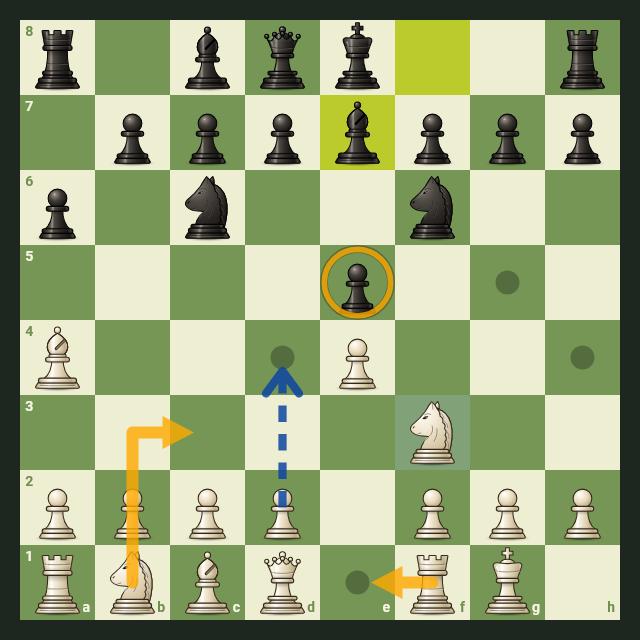

# modern_chess_board

A chess board widget for Flutter that plays like the chess sites people
already know: tap or drag to move, legal moves shown as you pick up a
piece, smooth animations, arrows, premoves, keyboard play and screen-reader
support. It runs on Android, iOS, web, Windows, macOS and Linux.



## Getting started

```sh
flutter pub add modern_chess_board
```

The controller holds the game. It is a `ChangeNotifier`, so keep it in a
`State` and dispose of it there:

```dart
import 'package:flutter/material.dart';
import 'package:modern_chess_board/modern_chess_board.dart';

class GamePage extends StatefulWidget {
  const GamePage({super.key});

  @override
  State<GamePage> createState() => _GamePageState();
}

class _GamePageState extends State<GamePage> {
  final controller = ChessBoardController();

  @override
  void dispose() {
    controller.dispose();
    super.dispose();
  }

  @override
  Widget build(BuildContext context) => ChessBoard(controller: controller);
}
```

That is a full two-player board: moves are checked against the rules,
castling works by moving the king two squares or onto its own rook,
promotions ask for a piece, and the game ends on checkmate or a draw. The
board sizes itself to the space it is given and stays square.

The `example/` app shows every option on one screen.

## The game: `ChessBoardController`

Anything you do through the controller shows on the board, animated.

```dart
final controller = ChessBoardController(fen: someFen);  // or start normally

controller.moveSan('e4');
controller.move(Square.e7, Square.e5);
controller.undo();
controller.reset();

controller.loadFen('rnbqkbnr/pppppppp/8/8/4P3/8/PPPP1PPP/RNBQKBNR b KQkq - 0 1');
ChessBoardController.isValidFen(text);  // check before loading
controller.loadPgn(pgnText);
controller.setPgnHeader('White', 'Ada');
final pgn = controller.pgn;

controller.status;              // GameStatus.ongoing, checkmate, stalemate or draw
controller.drawReason;          // why it's drawn, if it is
controller.turn;                // PieceColor.white or black
controller.history;             // the moves played, as BoardMove
controller.legalMovesFrom(Square.g1);
```

Step through a game without losing it:

```dart
controller.back();
controller.forward();
controller.goTo(4);        // the position after the 4th half-move
controller.goToEnd();
controller.allowBranching = true;  // let the user play on from an old position
```

To make several changes at once without the board or your listeners
reacting to each, pass `notify: false` to the actions (`move`, `moveSan`,
`undo`, `reset`, `loadFen`, `loadPgn` and navigation), then call
`controller.notifyListeners()` once at the end.

`ChessBoard(initialFen: ...)` sets a starting position for a fresh
controller without touching one that is already in use.

### Using the rules engine directly

`controller.engine` is the underlying `package:chess` game. That package
also defines `Piece`, `PieceType`, `Color` and `Move`, so import it with a
prefix:

```dart
import 'package:chess/chess.dart' as chess;
```

## Reacting to moves

```dart
ChessBoard(
  controller: controller,
  onMove: (move) => print(move.san),          // the user's moves
  onGameEnd: (end) => showResult(end.result, end.drawReason),
)
```

To play against an engine or a server, let the user move one side and make
the other side's moves through the controller:

```dart
ChessBoard(
  controller: controller,
  interactiveSide: InteractiveSide.white,
  enablePremoves: true,  // queue a move during the opponent's turn
  onMove: (_) async {
    final reply = await engine.bestMove(controller.fen);
    controller.moveSan(reply);
  },
)
```

`readOnly: true` shows a game without allowing moves; the arrow keys still
step through it, and the user can still draw arrows on it.

## Looks

```dart
ChessBoard(
  controller: controller,
  theme: ChessBoardTheme.brown,  // green (default), brown, blue, purple, monochrome
  orientation: BoardOrientation.black,  // changing it animates a flip
  coordinates: CoordinateMode.outside,  // inside (default), outside or none
  showLastMove: true,                   // the default
  animationDuration: const Duration(milliseconds: 150),  // zero turns it off
)
```

Animations also switch off when the platform asks for reduced motion.

For a quick tweak, set colors on the board itself; for more, make a theme
from a preset:

```dart
ChessBoard(controller: controller, darkSquareColor: const Color(0xFF7A5C45))

final theme = ChessBoardTheme.green.copyWith(
  lightSquareColor: const Color(0xFFF2E6D0),
  darkSquareColor: const Color(0xFF7A5C45),
);
ChessBoard(controller: controller, theme: theme)
```

### Piece sets

The bundled set is original artwork. To use your own SVGs, put twelve files
named `wK.svg`, `wQ.svg`, `wR.svg`, `wB.svg`, `wN.svg`, `wP.svg` and the
same with `b` in a folder, and list the folder under `flutter: assets:` in
your app's pubspec:

```dart
const pieces = PieceSet.svgAssets('assets/my_pieces');
ChessBoard(controller: controller, pieceSet: pieces)
```

Images and widgets work too. `PieceSet.images` needs all twelve pieces and
throws an `ArgumentError` naming any that are missing. Give a builder set
an `id`, so the board knows it is the same set on every rebuild:

```dart
final images = PieceSet.images({Piece.whiteKing: AssetImage('...'), /* all 12 */});
final custom = PieceSet.builder(
  (context, piece, size) => MyPiece(piece, size),
  id: 'my-pieces',
);
```

Switching sets keeps the old one on screen until the new one has loaded, so
pieces never flicker.

### Promotion

The default picker shows the four pieces in a column over the promotion
square. `autoQueen: true` skips it, and `promotionPickerBuilder` replaces it
with your own; `request.squareRect` says where the promotion square is
drawn, so you can place your picker over it:

```dart
ChessBoard(
  controller: controller,
  promotionPickerBuilder: (context, request) => MyPicker(
    at: request.squareRect,
    color: request.color,
    onPick: request.choose,
    onCancel: request.cancel,
  ),
)
```

## Arrows, marks and hints

```dart
ChessBoard(
  controller: controller,
  arrows: const [Arrow('g1', 'f3'), Arrow('d2', 'd4', color: Color(0xCC3366FF))],
  marks: const [SquareMark('e5'), SquareMark('d4', shape: MarkShape.fill)],
  hint: const Arrow('e2', 'e4'),          // dashed, in its own color
  hintTimeout: const Duration(seconds: 5),
)
```

`Arrow.fromSquares(Square.g1, Square.f3)` builds one from squares. The hint
disappears when the position changes or the timeout passes. Your `arrows`
and `marks` lists are never changed by the board.

Users can draw too: right-click and drag (or long-press and drag on touch)
for an arrow, and right-click or long-press a square for a circle. Shift,
Alt and Shift+Alt pick other colors. Drawing the same thing again in the
same color removes it; in another color, it recolors it.

```dart
ChessBoard(
  controller: controller,
  onUserArrowsChanged: (arrows) => save(arrows),
  onUserMarksChanged: (circles) => save(circles),
  clearUserAnnotationsOnMove: true,  // the default
  enableUserAnnotations: true,       // the default
)
```

## Sound and haptics

The package ships no audio and depends on no audio plugin. Give the board a
sound pack and it sends one event per move, `move`, `capture`, `check`,
`castle`, `promotion` or `gameEnd`, plus `illegal` for a rejected drop.
Undo, reset, loading, history navigation and `notify: false` changes play
nothing.

```dart
ChessBoard(
  controller: controller,
  soundPack: ChessSoundPack.callback((event) => player.play(event.name)),
)
```

Or subclass `ChessSoundPack`:

```dart
class MySounds extends ChessSoundPack {
  final player = AudioPlayer();  // from package:audioplayers, for example

  @override
  Future<void> play(SoundEvent event) =>
      player.play(AssetSource('sounds/${event.name}.mp3'));
}
```

Errors from your sound code are caught and reported; they never stop play.

`enableHaptics: true` adds light haptic feedback on Android and iOS phones
and tablets: a click when a piece is picked up, and a tap when it is
dropped on a square it can go to.

## Keyboard and accessibility

With the board focused (Tab, or a click), the arrow keys move a cursor,
Enter or Space acts like a tap, and Escape clears. Type a move such as
`Nf3`, `exd5`, `O-O` or `e2e4` and press Enter. Shift+H switches the arrow
keys to stepping through history, with Home and End jumping to its ends.
Pass `enableKeyboard: false` to turn this off.

Screen readers see every square ("e4, white pawn"), can make moves with the
usual activate gesture, and hear each move ("White knight to f3, check").
To word announcements in another language, pass a `moveAnnouncer`, and use
`semanticsLabel` to name the board:

```dart
ChessBoard(
  controller: controller,
  semanticsLabel: 'Schachbrett',
  moveAnnouncer: (BoardMove move, DrawReason? drawReason) => 'Zug ${move.san}',
)
```

## Performance

Selecting, hovering, dragging and animating never rebuild the board as a
whole; only the layers that change repaint. Legal moves are worked out once
per position.

## License

MIT. The bundled piece artwork in `assets/pieces/default/` is original work
by the package author and is covered by the same license.
